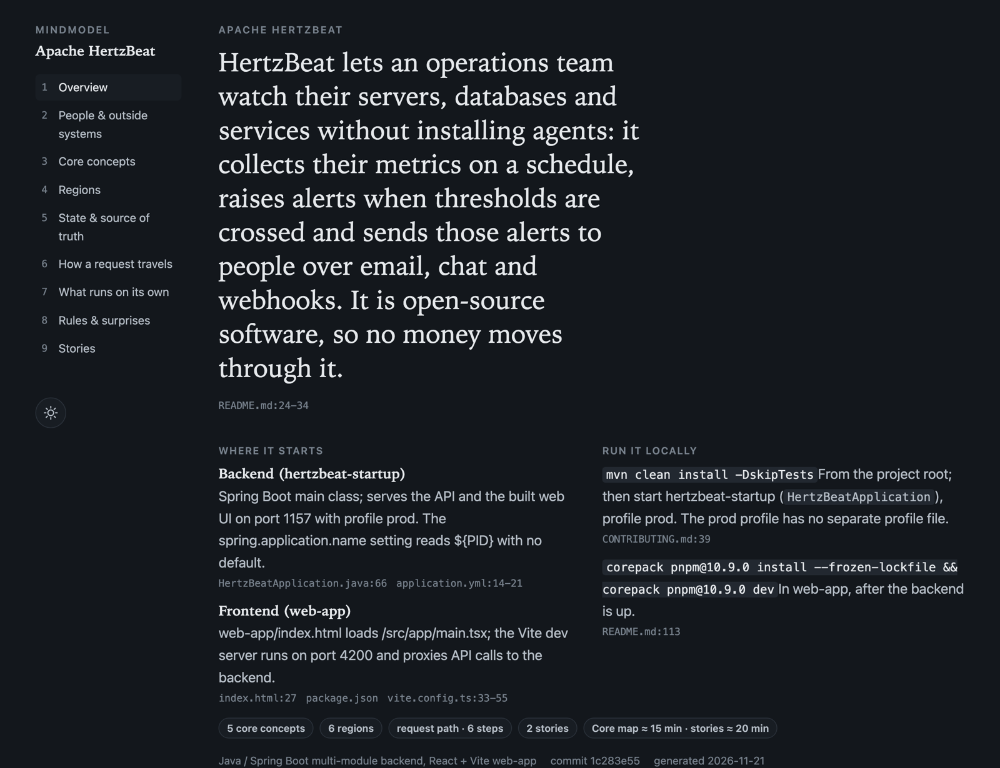
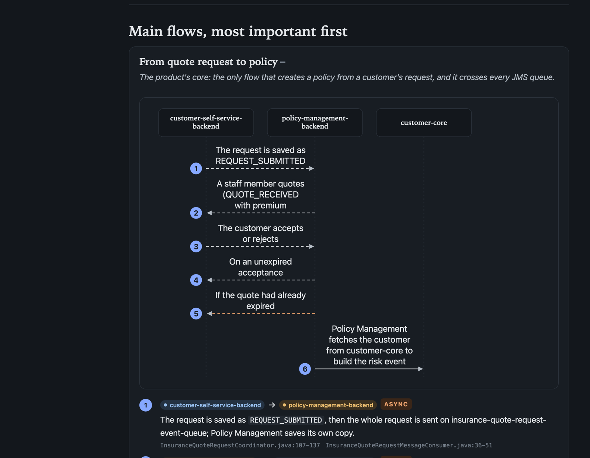

# Mindmodel: the codebase mental model for humans

**The few things every developer on a project must know by heart, on one page, generated from the code.** A [Claude Code](https://claude.com/claude-code) plugin: run `/mindmodel` in any project, or `/mindmodel-system` on a folder of services to see how they fit together.

It is deliberately *not* complete. Graph tools show hundreds of nodes; mindmodel distills the essence.

## Example

[](https://imbacraft.github.io/mindmodel/examples/hertzbeat.html)

**[Open the live example →](https://imbacraft.github.io/mindmodel/examples/hertzbeat.html)** The mindmodel of [Apache HertzBeat](https://github.com/apache/hertzbeat), a monitoring platform of about 316k lines of Java and 199k of TypeScript, generated in about 5 minutes. Every citation links to the code on GitHub at the mapped commit. *HertzBeat is an Apache Software Foundation project; this example is independent and not affiliated with it.*

## What the page contains
1. **Overview:** what the system is for, what it deliberately is not, where it starts, and the one way to run it locally.
2. **People & outside systems:** who it serves, most important first, and which outside systems it calls.
3. **Core concepts:** the ≤ 5 things everything else is about, one sentence linking them, and a card each (what it is, what not to confuse it with, its lifecycle, the fields that matter).
4. **Regions:** where the code lives, ordered along the user's journey, with how often each part changes.
5. **State & source of truth:** where the truth for each concept lives, which code may change it (shared writes flagged), copies that can go stale, and steps that can half-succeed.
6. **How a request travels:** the path every API call takes, as one sequence diagram.
7. **What runs on its own:** scheduled jobs, webhooks, queues and async work.
8. **Rules & surprises:** ranked by how much code they touch × how bad it is to get them wrong.
9. **Stories:** the main flows, walked end to end through real code.

Every citation opens the file at the line in VS Code or IntelliJ.

## System maps for microservices
For a system of many services, `/mindmodel-system` maps what happens **between** them: what no single repo can show.
1. **Overview:** what the platform does, and one sentence on how business flows through its domains.
2. **Domains & services:** services grouped by business domain and ranked core → supporting → peripheral, each with what it decides and what it owns.
3. **Who owns what:** the one service that is the source of truth for each core concept, every copy kept elsewhere and how it is fed; shared and dual writes flagged.
4. **How it talks:** the domains in flow order, plus a table of every service's REST calls and the Kafka/JMS channels it publishes and listens to.
5. **Main flows:** the key cross-service flows hop by hop, sync or async, with a sequence diagram each, replies and compensations included.
6. **When a hop fails:** what happens when the other side is down, slow, or a message arrives twice: retries, idempotency, dead letters, outbox, or nothing.
7. **System rules & surprises:** conventions every service must follow, and the traps.

[](https://imbacraft.github.io/mindmodel/examples/lakeside.html)

**[Open the live system example →](https://imbacraft.github.io/mindmodel/examples/lakeside.html)** The system mindmodel of [Lakeside Mutual](https://github.com/Microservice-API-Patterns/LakesideMutual), a sample insurance company built from Spring Boot services that talk over REST and JMS (ActiveMQ). Every citation links to the code on GitHub at the mapped commit. *Lakeside Mutual is a sample application by the authors of Microservice API Patterns; this example is independent and not affiliated with it.*

Connections are **proven, not guessed**: the scanner matches every send to its listeners and every call to the service it reaches, resolving names from code, config and shared constants. Names it can't resolve (often set only in deployment config) are listed as unresolved. It reads Spring Kafka, Kafka Streams, Spring Cloud Stream, JMS and Eventuate Tram out of the box; if your services wrap Kafka or JMS in a company library, add its patterns in a `mindmodel-system.json` file in the folder.

## Install (Claude Code)
```
/plugin marketplace add imbacraft/mindmodel
/plugin install mindmodel@mindmodel
```
Then, in any project:
```
/mindmodel                # the current directory
/mindmodel path/to/app    # or a specific project
```
For a system, point it at the folder that holds the service repos side by side:
```
/mindmodel-system path/to/services
```
The page is written to `<project>/mindmodel/index.html` (or `<folder>/mindmodel-system/index.html`); open it in any browser, offline.

### Requirements
- Claude Code (the analysis runs on your own Claude plan and model)
- Node.js 18+ (the scanner, validator and renderer have no npm dependencies)
- git (optional; used for the "changes often / rarely" badges)

### Best results
v1 is tuned for **Spring/Java backends** with **React, Vue, Svelte or Angular** SPAs or **server-rendered (JSP/Thymeleaf)** frontends. File-based routing (Next.js, Nuxt, SvelteKit) is not read yet. Other stacks work with generic signals and give weaker results.

## How it works
1. **Pre-flight** (`engine/preflight.mjs`): checks the code is a clean, current state. Uncommitted changes, being behind the remote, a detached HEAD or a non-default branch make it ask you to confirm before continuing.
2. **Scan** (`engine/scan.mjs`, no AI): collects the mechanical facts (entities and their relations, endpoints, the frontend↔backend API join, security, scheduled/async work, external SDKs, docs, git history) and computes what used to need reading: how to boot the app, transaction seams, every place each status is set, schedules in plain words, and flow skeletons per entry point. Everything goes into `mindmodel/.work/facts.json` plus a compact digest of fixed size, whatever the size of the app.
3. **Write** (one Claude subagent): follows [`rules/generation-rules.md`](rules/generation-rules.md) to choose what is essential, reading only the code that needs judgment.
4. **Validate** (`engine/validate.mjs`): schema, size budgets, and every citation (files, line ranges, and `#symbol` checks); fills in exact line ranges and computes the activity badges.
5. **Render** (`engine/render.mjs`): a fixed template turns `mindmodel.json` into one self-contained HTML file.

The system map works the same way: `engine/system.mjs` scans every service and joins their connections, one subagent follows [`rules/system-rules.md`](rules/system-rules.md), and `engine/system-render.mjs` validates and renders.

## Privacy and safety
- The scanner reads configuration **keys only, never values**, and the rules forbid secrets in the map.
- Security weaknesses or serious bugs found during analysis are reported **to you in the session**, never written into the map.
- The page describes your code in detail. Review it before committing it to a public repository.
- `mindmodel/.work/` holds scan data; add it to your project's `.gitignore`.

## License
MIT
